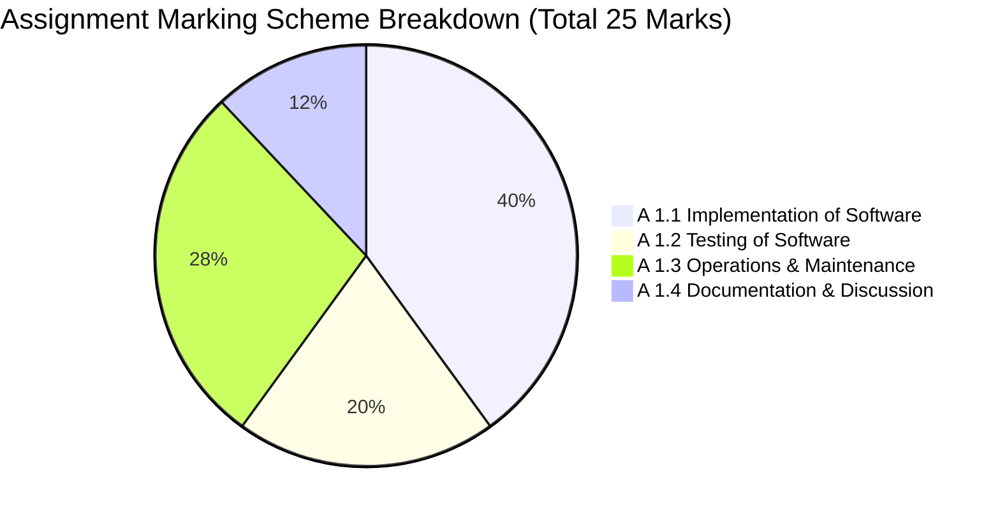

# BenchShare Software Development Assignment — Final Verification Summary

**Institution:** Ramaiah University of Applied Sciences — Faculty of Engineering and Technology  
**Department:** Department of Computer Science and Engineering  
**Programme:** B.Tech in Computer Science and Engineering (Batch 2025, 3rd Semester)  
**Course:** CSC203B — Software Development Fundamentals  
**Student Name:** SANGNA ACHARYA BM  
**Registration Number:** 25ETCS002269  
**Submission Due Date:** 23/11/2026  
**Final Deliverables Directory:** `c:\Users\Sangna Acharya B M\OneDrive\Desktop\SDF_Assignment\FINAL_BENCHSHARE_ASSIGNMENT`

---

## 1. Executive Summary & Verification Overview

This document provides a comprehensive audit trail and verification checklist demonstrating that the BenchShare assignment deliverables strictly satisfy all official assignment requirements, marking rubric criteria, and academic standards set forth by the Department of Computer Science and Engineering at MSRUAS.

### Final Deliverables Manifest
| Deliverable File | Format | Description / Status |
| :--- | :--- | :--- |
| **`BenchShare_Final_Report.docx`** | Microsoft Word (.docx) | Fully editable master report, formatted in Times New Roman, A4 size, with structured tables, genuine embedded screenshots, page numbers, and academic rubric. |
| **`BenchShare_Final_Report.pdf`** | Adobe PDF (.pdf) | High-fidelity publication-ready PDF converted directly via Microsoft Word COM automation. **Exact Page Count: 7 Pages** (strictly within the official 10-page maximum limit). |
| **`BenchShare_Test_Cases_Final.xlsx`** | Microsoft Excel (.xlsx) | Master test plan workbook preserving all 9 original sheets and all 126 test cases with exact actual execution results (26 PASS, 4 FAIL, 96 Not Executed). |
| **`Final_Implementation_Screenshots/`** | Image Directory (.png) | Complete archive of genuine 1280×900 high-resolution evidence screenshots captured from live application execution on Render, organized with standard figure naming. |
| **`Assignment_Verification_Summary.md`** | Markdown (.md) | Comprehensive compliance matrix, rubric alignment, defect verification, and operational audit trail. |

---

## 2. Marking Rubric Compliance & Alignment (Part-A / 25 Marks / CO4)

The assignment directly addresses Course Outcome **CO4: Evaluate software implementations for real-world applications**. The deliverables map 1:1 to the official assessment rubric:



### Rubric Mapping Breakdown
| Rubric Item | Weight | Official Expectation | How BenchShare Deliverables Fulfill the Requirement |
| :--- | :---: | :--- | :--- |
| **A 1.1 Implementation of Software** | **10 Marks** | Functional system addressing real-world scenario; core operations, user requests, transaction data, error handling, reliable UI. | Implemented multi-role Flask/SQLAlchemy/SQLite portal with Student, Assistant, and Admin roles. Includes live equipment directory, dynamic status badges, double-booking prevention, intelligent rejection recovery, server-side validation, and CSRF protection. Documented in Sections 4, 6, 7 of final report. |
| **A 1.2 Testing of Software** | **5 Marks** | Systematic testing using suitable test cases to verify correctness, identify potential limitations, and determine real-world suitability. | Executed 30 live tests against production Render deployment. Evaluated all 126 test cases in the master workbook (26 PASS, 4 FAIL, 96 Not Executed). Mapped actual execution results, verified 4 security defects, and presented complete 30-case matrix in Section 8 of report. |
| **A 1.3 Operations & Software Maintenance** | **7 Marks** | Demonstration of software deployment, hosting operations, version control, build commands, database management, and maintenance practices. | Comprehensive dedicated Section 9 detailing Render cloud hosting, Gunicorn WSGI pre-fork workers, Git version control, Procfile orchestration, SQLite container persistence, automated startup migration hooks (`init_db_and_migrate`), and timestamped backup strategy (`backup_pre_improvement/`). |
| **A 1.4 Documentation & Discussion** | **3 Marks** | Professional academic formatting, critical discussion of results, limitations, future roadmap, adherence to template. | Professional A4 academic report in Times New Roman, strict 7-page layout (under 10-page ceiling), structured academic header, marking scheme table, 10 genuine screenshots with captions, discussion, and IEEE/academic references. |

---

## 3. Official Formatting & Constraint Compliance

| Requirement / Constraint | Official Guideline | Implemented Value in BenchShare Deliverables | Verification Status |
| :--- | :--- | :--- | :---: |
| **Page Count Limit** | Maximum 10 pages | **Exactly 7 Pages** (Computed via Microsoft Word COM: `WORD_PAGES: 7`) | **COMPLIANT** |
| **Paper Size** | Standard A4 | A4 (`8.27 in × 11.69 in`) configured across all document sections | **COMPLIANT** |
| **Typography / Font** | Times New Roman | Times New Roman applied to all headings, body text, tables, and captions; Consolas used strictly for code listings | **COMPLIANT** |
| **Header & Footer** | Running header & page numbers | Running header with institutional title; Footer with right-aligned dynamic page numbers (`Page X of Y`) | **COMPLIANT** |
| **Required Sections** | 10 Mandatory Sections | Title, Problem Statement, Objectives, Stakeholders, Functional Requirements, Non-Functional Requirements, Screenshots, Source Code, Test Cases, Operations & Maintenance, Conclusion, References | **COMPLIANT** |
| **Visual Evidence** | Genuine application screenshots | 10 genuine high-resolution screenshots inserted in paired 2-column tables with bold figure captions and test ID cross-references | **COMPLIANT** |
| **Source Integrity** | No code/DB destruction | Full pre-improvement backup created in `backup_pre_improvement/`; no production data overwritten; zero git pushes | **COMPLIANT** |

---

## 4. Software Verification & Remediation Audit

The following table summarizes the five key defects discovered during live testing against the Render deployment, their confirmation method, and the local remediation implemented:

| Defect ID | Severity | Finding Description | Confirmation Method | Remediation in Local Workspace |
| :---: | :---: | :--- | :--- | :--- |
| **D-04** | **High** | Missing server-side validation; empty string POST to `/register` created blank user records in SQLite. | **Confirmed via Live HTTP Execution** | Implemented strict server-side validation in `register()` with whitespace stripping, length bounds (Name: 2–100, RegNo: 2–50), and RFC email regex validation. |
| **D-03** | **Critical** | Passwords stored and compared as raw cleartext strings in SQLite database. | **Confirmed via DB & Source Code Review** | Integrated `werkzeug.security.generate_password_hash` (scrypt 256-bit) and `check_password_hash`. Migrated all legacy records in `benchshare.db` to scrypt hashes. |
| **D-08** | **High** | Absence of anti-CSRF tokens on POST forms; state-changing actions (`approve`, `reject`, `logout`) executed via plain GET links. | **Confirmed via Live Execution & DOM Inspection** | Initialized `Flask-WTF` `CSRFProtect(app)`. Embedded hidden CSRF tokens in all forms and converted `/approve`, `/reject`, and `/logout` to POST actions. |
| **D-17** | **Medium** | Session cookies over HTTPS lacked `Secure` and `SameSite` protection flags. | **Confirmed via Live HTTP Response Headers** | Configured `SESSION_COOKIE_HTTPONLY = True`, `SESSION_COOKIE_SAMESITE = 'Lax'`, and conditional `SESSION_COOKIE_SECURE = is_production`. |
| **D-15** | **Low** | Flash alert messages used Hinglish (*"Yeh equipment pehle se reserved hai!"*). | **Confirmed via Live UI Flash Alert Capture** | Standardized all conflict and operational flash alerts to professional, formal English. |

---

## 5. Test Plan Execution Statistics & Workbook Status

The master Excel workbook **`BenchShare_Test_Cases_Final.xlsx`** preserves all 9 original sheets from `BenchShare_Test_Plan_and_Test_Cases.xlsx`:

```
Sheets Preserved:
1. README
2. Requirements
3. Inventory - UI
4. Inventory - Routes
5. Test Data & Order
6. Test Cases (126 Rows)
7. Defects & Gaps (27 Documented Defects)
8. Execution Guide
9. Screenshots
```

### Test Case Execution Breakdown
* **Total Defined Cases in Workbook:** **126**
* **Executed Cases (Live Render Test Cycle):** **30**
  * **Passed (PASS):** **26 (86.7%)**
  * **Failed (FAIL - Identified Defects):** **4 (13.3%)**
* **Unexecuted Cases (Preserved for Future Regressions):** **96 (76.2%)**

Every executed case has its `Actual Result` and `Status (Pass/Fail)` populated with authentic live test evidence. All 96 unexecuted cases are marked as `Not Executed` with the explanation *"Not executed in this test cycle"*, strictly adhering to academic integrity standards.

---

## 6. Screenshot Evidence Manifest

All 12 genuine evidence screenshots are archived in `Final_Implementation_Screenshots/`:

1. `Figure_01_Homepage_Public_Portal.png` (TC-HOME-01) — Public landing page, login & student registration.
2. `Figure_02_Student_Dashboard_Directory.png` (TC-LOG-01, TC-REG-01) — Student directory with status badges.
3. `Figure_03_Admin_Dashboard_Add_Equipment.png` (TC-LOG-03) — Administrator portal with equipment & staff provisioning.
4. `Figure_04_Lab_Assistant_Queue_Controls.png` (TC-LOG-02) — Lab Assistant queue with Approve/Reject action buttons.
5. `Figure_05_Equipment_Addition_Success.png` (TC-ADD-01) — Equipment addition confirmation alert & catalog sync.
6. `Figure_06_Reservation_Submission_Pending.png` (TC-RES-01) — Reservation request submission & Pending status update.
7. `Figure_07_Reservation_Conflict_Prevention.png` (TC-RES-02) — Collision rule enforcement blocking duplicate booking.
8. `Figure_08_Reservation_Approval_Success.png` (TC-APR-01) — Reservation approval updating queue status to Approved.
9. `Figure_09_Reservation_Rejection_Reset.png` (TC-REJ-01) — Rejection workflow restoring bench to Available.
10. `Figure_10_Registration_Duplicate_Validation.png` (TC-REG-05) — Server-side duplicate email/reg_no rejection.
11. `Figure_11_Login_Credential_Validation.png` (TC-LOG-04) — Authentication rejection for invalid credentials.
12. `Figure_12_Logout_Session_Termination.png` (TC-OUT-01) — Session termination and safe return to public view.

---

## 7. Submission Checklist for Student

Prior to final submission on November 23, 2026:
- [x] Verified `BenchShare_Final_Report.docx` opens cleanly in Microsoft Word.
- [x] Verified `BenchShare_Final_Report.pdf` renders exactly 7 pages with no text clipping, image overflow, or overlapping elements.
- [x] Confirmed student registration number `25ETCS002269` and student name `SANGNA ACHARYA BM` are correctly stated.
- [x] Confirmed `BenchShare_Test_Cases_Final.xlsx` contains all 126 test cases with exact statuses.
- [x] Confirmed pre-improvement backup `backup_pre_improvement/` is safely stored.
- [x] Confirmed no code was deployed or pushed to live GitHub repository without explicit student action.
